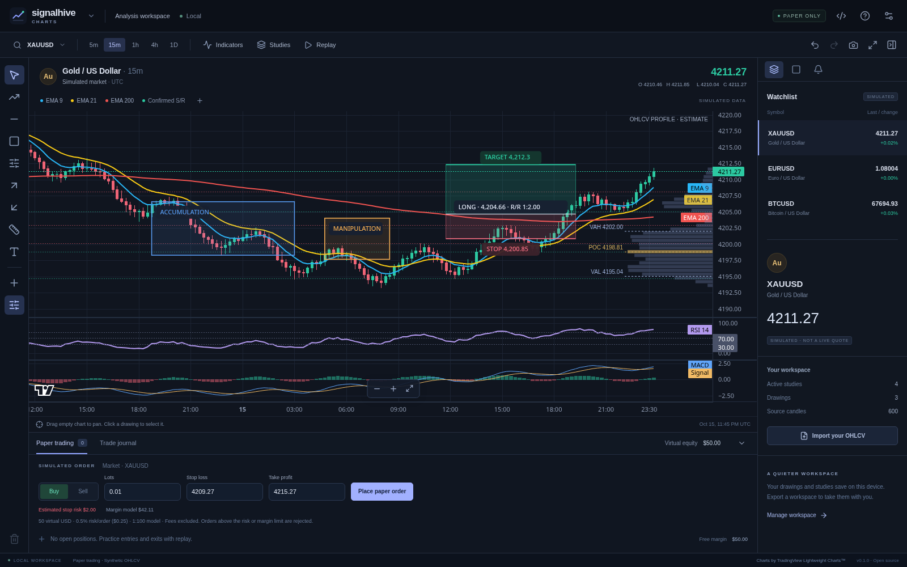

# Signalhive Charts

A free, open-source charting workbench for studying price, drawing a plan, and practicing with paper trading. A focused dark interface, crisp canvas charts and a small, organized toolset—without account registration or subscriptions.

**Early release.** The app starts with clearly labeled, deterministic **simulated OHLCV**. Import your own CSV for other history. There is no live market feed, broker connection, real-money execution or background account copier.



## What works

- Candlestick charts, pan/zoom, draggable price scales, resizable indicator panes and PNG export.
- EMA **9 blue**, **21 yellow**, **200 red**; SMA 50, Bollinger 20/2, Wilder RSI 14, MACD 12/26/9, ATR 14, volume and confirmed support/resistance.
- Editable trend lines, rays, horizontal/vertical levels, rectangles, ellipses, parallel channels, Fibonacci retracements, arrows, text and price/time measurements.
- Long/short position drawings: green target, red stop, editable anchors and risk/reward ratio. These are drawings, not orders.
- Named **Accumulation / Manipulation / Distribution** zones, with independent colors. These are manual annotations, not a claim to detect institutional activity.
- Fixed-range **estimated volume profile** with POC, VAH and VAL. Draw a time range or choose recent bars. The profile distributes candle volume uniformly across each candle's high/low interval. It is **not** tick-at-price, bid/ask delta, footprint, DOM or order-flow data.
- Drawing object list, hide/lock/color/labels, undo/redo and local persistence.
- Searchable indicator library, study presets and a JSON study editor. It does not execute arbitrary code or Pine Script.
- Bar replay, local closing-price alerts, $50 virtual paper account, manual close and SL/TP simulation, journal export.
- CSV import/export, workspace backup/import, responsive touch layout and offline-capable PWA.

The complete TradingView drawing catalogue contains tools outside this first release. See [tool coverage](docs/TOOLS.md) and [roadmap](docs/ROADMAP.md) for the exact boundaries.

## Run locally

Use Node.js 24+ and npm:

```sh
npm ci
npm run dev
```

Open the local URL printed by Vite (port 1420). For a distributable frontend:

```sh
npm run build
npm run preview
```

The generated `dist` directory can be served by any static HTTP server. Do not open `index.html` directly with a `file://` URL: JavaScript modules need an HTTP or app origin.

## Install and download

- **Web / Android PWA:** open the [web app](https://maaskk.github.io/signalhive-charts/), then use your browser's **Install app / Add to Home screen** menu. It works offline after the first successful load. Browser support for installation differs.
- **Windows / macOS / Linux / Android packages:** see [Releases](https://github.com/Maaskk/signalhive-charts/releases) for the actual artifacts produced by CI. A build configuration is not evidence that a package is available or tested on hardware.
- Native packaging uses Tauri 2. macOS and Windows releases are initially unsigned; Android preview APKs use a development signing identity and are not a Play Store release. See [platform builds](docs/PLATFORMS.md).

## Use it

1. Pick a market and timeframe, or import an OHLCV CSV from the workspace menu.
2. Open **Indicators** to enable studies. **Studies** contains complete layouts and the study editor.
3. Choose a tool on the left; **+** opens all drawing tools and AMD phase zones. Select an object to drag its body or handles.
4. Open the **Drawings** side tab to name, recolor, hide or lock objects; use its volume-profile controls to draw a time range.
5. Start **Replay** to reveal candles one at a time. Paper orders require valid stops, sufficient margin and the virtual account's risk limits. Use **Close now** to exit early.

Press **?** for the in-app guide. Useful shortcuts: V select/pan, T trend, H level, R rectangle, F Fibonacci, L long, S short, M measure, N note, Esc cancel, Delete selected, Ctrl/⌘+Z undo, Ctrl/⌘+Shift+Z redo, Ctrl/⌘+K symbol search. Shortcuts do not fire while typing in inputs.

### Data format

CSV header:

```csv
time,open,high,low,close,volume
2026-01-01T00:00:00Z,100,102,99,101,1500
2026-01-01T00:15:00Z,101,103,100,102,1800
```

Time may be integer Unix UTC seconds or an ISO timestamp. Timestamps must be within 1970–2100. Rows must be strictly chronological and contain finite valid OHLC prices and nonnegative volume. CSVs retain their original candle interval; the timeframe selector does not fabricate lower-resolution data. Maximum import: 100,000 candles and 15 MB. Read [data and execution assumptions](docs/DATA.md).

## Testing

```sh
npm test
npm run build
npx playwright install chromium
npm run test:e2e
```

The UI suite also accepts `CHROMIUM_PATH` for a system Chromium. Tests cover indicator values, causal pivots, CSV validation, volume conservation, drawing geometry, paper sizing/exits and browser/touch workflows. They do not certify broker execution or native platform behavior.

## Privacy and contributions

The app has no login, telemetry or account credential fields. Imported data, layouts and virtual trades stay in browser/app local storage. There is no server upload path. Export backups before clearing browser data or changing the app's origin. Never commit broker credentials, Telegram sessions, private recovery files or signing keys.

Contributions are welcome: see [CONTRIBUTING.md](CONTRIBUTING.md), [SECURITY.md](SECURITY.md) and the roadmap. Our code is MIT-licensed; dependencies retain their own licenses. Charting uses [TradingView Lightweight Charts™](https://www.tradingview.com/lightweight-charts/), Apache 2.0, with attribution retained. This independent project does not distribute proprietary TradingView tools or claim Pine compatibility.
