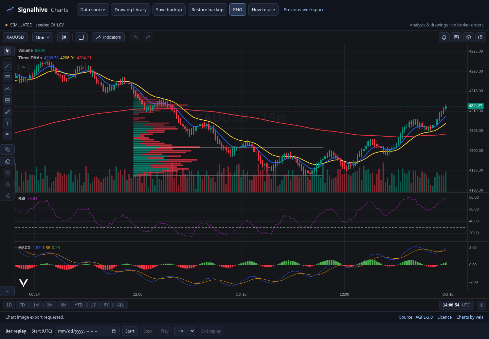

# Signalhive Charts

A free, open-source charting workbench for studying price, drawing a plan, and practicing with paper trading. A focused dark interface, crisp canvas charts and a small, organized toolset—without account registration or subscriptions.

**Development update:** the default workspace now uses Vela with editable drawings, chart settings, multiple charts and bundled worker-based EMA/RSI/MACD studies. The previous paper-trading workspace remains available through **Previous workspace**. This has not yet been released as a new native package and does not deliver every paid TradingView feature. See the [workspace guide](docs/WORKBENCH.md) and [feature gap audit](docs/PAID-FEATURE-AUDIT.md).

**Early release.** The app starts with clearly labeled, deterministic **simulated OHLCV**. Import your own CSV for other history. An optional, read-only local MT5 demo adapter can supply broker candles in the installed Linux app. There is no broker order execution, real-money execution or automatic account copier. The web/mobile preview uses CSV or simulated data.



## New workspace

- Searchable drawing catalogue backed by Vela's actual registered tools: lines, channels, Fibonacci, patterns, annotations, positions, anchored VWAP and fixed-range volume profiles. A listed tool is not a claim of numerical parity with TradingView.
- Native drawing property dialogs, anchor editing, snapping, undo/redo, object tree and per-source layout persistence. Fixed-range profiles have editable row counts, value-area percentage, colors and POC/VAH/VAL controls; OHLCV-based profiles remain estimates.
- Editable candles, chart styles and multiple chart layouts. One chart opens by default to reduce resource use.
- Three bundled Pine studies: EMA 9 blue / 21 yellow / 200 red, RSI and MACD. Their period/color inputs are editable. Execution uses PineTS in a worker and is restricted to the bundled sources; arbitrary Pine compatibility is not claimed.
- Simulated data, persistent CSV import with compatible higher intervals, UTC bar replay, workspace backups and chart-image export. The local MT5 demo source remains optional and read-only, with no silent source substitution.

## Previous workspace

- Candlestick charts, pan/zoom, draggable price scales, resizable indicator panes and PNG export.
- Editable study periods, colors, widths and reference levels, saved with the workspace. Defaults: EMA **9 blue**, **21 yellow**, **200 red**; SMA 50, Bollinger 20/2, Wilder RSI 14, MACD 12/26/9, ATR 14, volume and confirmed support/resistance.
- Drawing property dialogs with exact prices/UTC anchors, widths, dashes, fills, opacity, fonts, extensions, Fibonacci ratios/colors/reversal and position colors.
- Editable trend lines, rays, horizontal/vertical levels, rectangles, ellipses, parallel channels, Fibonacci retracements, arrows, text and price/time measurements.
- Long/short position drawings: green target, red stop, editable anchors and risk/reward ratio. These are drawings, not orders.
- Named **Accumulation / Manipulation / Distribution** zones, with independent colors. These are manual annotations, not a claim to detect institutional activity.
- Fixed-range **estimated volume profile** with POC, VAH and VAL. Draw a time range or choose recent bars. The profile distributes candle volume uniformly across each candle's high/low interval. It is **not** tick-at-price, bid/ask delta, footprint, DOM or order-flow data.
- Drawing object list, hide/lock/color/labels, undo/redo and local persistence.
- Searchable indicator library, study presets and a JSON study editor. It does not execute arbitrary code or Pine Script.
- Bar replay, local closing-price alerts, $50 virtual paper account, risk-based auto-sizing, partial/manual closes, draggable protective SL/TP and journal export.
- CSV import/export, workspace backup/import, responsive touch layout and offline-capable PWA.

The complete TradingView drawing catalogue contains tools outside this first release. See [tool coverage](docs/TOOLS.md) and [roadmap](docs/ROADMAP.md) for the exact boundaries.

## Run locally

Use Node.js 24+ and npm:

```sh
npm ci
npm run dev
```

Open the local URL printed by Vite (port 1420). For a distributable frontend:

```sh
npm run build
npm run preview
```

The generated `dist` directory can be served by any static HTTP server. Do not open `index.html` directly with a `file://` URL: JavaScript modules need an HTTP or app origin.

## Install and download

- **Web / Android PWA:** open the [web app](https://maaskk.github.io/signalhive-charts/), then use your browser's **Install app / Add to Home screen** menu. It works offline after the first successful load. Browser support for installation differs.
- **Windows / macOS / Linux / Android packages:** see [Releases](https://github.com/Maaskk/signalhive-charts/releases) for the actual artifacts produced by CI. A build configuration is not evidence that a package is available or tested on hardware.
- Native packaging uses Tauri 2. macOS and Windows releases are initially unsigned; Android preview APKs use a development signing identity and are not a Play Store release. See [platform builds](docs/PLATFORMS.md).

### Linux app menu

After `npm run build`, run `python3 scripts/install-linux.py` to install a local app icon. The preview opens its bundled code in a dedicated Chromium application window and stops its loopback server when closed. It does not open a remote website or use your everyday browser profile. When a native release AppImage is available, `python3 scripts/install-linux.py --native /path/to/verified.AppImage` installs that native build behind the same icon.

## Use it

1. Pick a market and timeframe, or import an OHLCV CSV from the workspace menu.
2. Open **Indicators** to enable studies. **Studies** contains complete layouts and the study editor.
3. Choose a tool on the left; **+** opens all drawing tools and AMD phase zones. Select an object to drag its body or handles.
4. Open the **Drawings** side tab to name, recolor, hide or lock objects; use its volume-profile controls to draw a time range.
5. Start **Replay** to reveal candles one at a time. Paper orders require valid stops, sufficient margin and the virtual account's risk limits. Use **Close now** to exit early.

Press **?** for the in-app guide. Useful shortcuts: V select/pan, T trend, H level, R rectangle, F Fibonacci, L long, S short, M measure, N note, Esc cancel, Delete selected, Ctrl/⌘+Z undo, Ctrl/⌘+Shift+Z redo, Ctrl/⌘+K symbol search. Shortcuts do not fire while typing in inputs.

### Data format

CSV header:

```csv
time,open,high,low,close,volume
2026-01-01T00:00:00Z,100,102,99,101,1500
2026-01-01T00:15:00Z,101,103,100,102,1800
```

Time may be integer Unix UTC seconds or an ISO timestamp. Timestamps must be within 1970–2100. Rows must be strictly chronological and contain finite valid OHLC prices and nonnegative volume. CSVs retain their original candle interval; the timeframe selector does not fabricate lower-resolution data. Maximum import: 100,000 candles and 15 MB. Read [data and execution assumptions](docs/DATA.md).

## Testing

```sh
npm test
npm run build
npx playwright install chromium
npm run test:e2e
```

The UI suite also accepts `CHROMIUM_PATH` for a system Chromium. Tests cover indicator values, causal pivots, CSV validation, volume conservation, drawing geometry, paper sizing/exits and browser/touch workflows. They do not certify broker execution or native platform behavior.

## Local MT5 demo data

The optional [read-only adapter](bridge/README.md) reads an already-open demo terminal through the official Windows MT5 SDK. The installed Linux launcher can host its protected local snapshot at `127.0.0.1:18743/api/mt5`. It checks origins and private-file ownership. Account credentials and identifiers are omitted; no order-sending API exists. File freshness and broker-quote freshness are separate, so weekend/stale quotes remain labeled. A failed adapter preserves its last chart with a disconnected label, never a silently substituted simulated feed.

The included Linux/Wine launcher integration is verified separately from the cross-platform charting UI. Mobile devices cannot reach a PC terminal through their own localhost; remote/mobile MT5 access is not implemented. MT5 mode is analysis only. Disconnect it to practice with the separate virtual replay/CSV ledger.

## Privacy and contributions

The app has no login, telemetry or account credential fields. The optional read-only local adapter displays demo account totals without login IDs or credentials. Imported data, layouts and virtual trades stay in browser/app local storage. There is no server upload path. Export backups before clearing browser data or changing the app's origin. Never commit broker credentials, Telegram sessions, private recovery files or signing keys.

Contributions are welcome: see [CONTRIBUTING.md](CONTRIBUTING.md), [SECURITY.md](SECURITY.md) and the roadmap. The combined application is now **AGPL-3.0-only** because it incorporates Vela-PineTS and PineTS. The original application code's MIT notice is preserved in [LICENSE-MIT](LICENSE-MIT). Vela is Apache-2.0; its licence and required attribution are retained in [LICENSE.Vela](LICENSE.Vela) and [NOTICE.Vela](NOTICE.Vela), and visible on chart screens. The previous workspace uses TradingView Lightweight Charts, Apache-2.0, with its attribution retained. Dependencies retain their own notices. This independent project does not distribute proprietary TradingView software or claim complete Pine compatibility.
